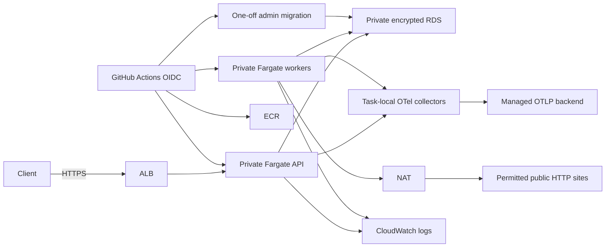

# AWS architecture

Definitions in `infra/` target ECR, two independent Fargate services, HTTPS ALB, private RDS PostgreSQL 16, task roles, GitHub environment OIDC, CloudWatch and budget alerts. Terraform 1.10.5 is used for local validation; AWS provider is selected and pinned by `.terraform.lock.hcl`. No resources have been provisioned.

The load balancer accepts 443 and redirects 80. Task ingress allows only ALB → API:8000. `/internal` paths return 404 at the ALB. RDS ingress is only task security group → 5432. Database subnets have no Internet route. Private task subnets use NAT for public crawling, ECR/logs/secrets endpoints and telemetry. HTTP/HTTPS egress is open to public destinations; this is not a domain allowlist. Application connector validation blocks private and metadata destinations; stronger egress policy requires an approved proxy/firewall design.

Application tasks use `atlaspipe_app` with RDS IAM tokens and certificate/hostname verification. The included certificate bundle comes from the [official RDS trust store](https://truststore.pki.rds.amazonaws.com/global/global-bundle.pem). Token signing happens per new connection. Only the migration execution role can retrieve RDS's managed master secret; it runs Alembic then grants DML/sequence privileges to the IAM login role. Runtime tasks cannot read that admin secret and cannot run DDL. Secret values are never Terraform inputs or outputs.

API and metrics secrets must exist in Secrets Manager before apply. The collector receives a separate managed OTLP authorization secret. Worker containers receive the metrics credential, not the API write credential. Confirm customer-managed KMS key permissions through `secret_kms_key_arns`. Secrets injected by ECS are refreshed on task replacement; restarting API tasks is required after API-key rotation.

The default demo has one API replica, two workers, single-AZ RDS and one NAT gateway. This has AZ failure and maintenance downtime limits. Production availability needs multiple API replicas, Multi-AZ RDS, a NAT per AZ and tested recovery. Set `multi_az` and `nat_per_az` explicitly; these increase recurring cost. No autoscaling or HA claim is made from definitions alone.

CloudWatch receives JSON application logs and native CPU/ALB alarms with recovery notifications. A task-local collector sends metrics and traces to an HTTPS managed backend. Import the local dashboard/alert definitions into the selected backend and verify notification routing there. The optional collector cannot terminate application processing; missing telemetry must be monitored externally.

The initial empty-image configuration keeps service desired counts zero until an image is published and the controlled migration succeeds. The release process subsequently owns task revisions and desired counts; Terraform ignores those fields to avoid undoing a release. Infrastructure edits still require a reviewed real-account plan.
