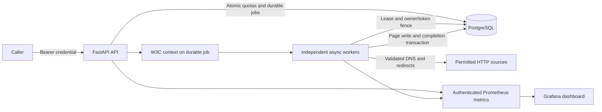

# AtlasPipe engineering showcase: implementation report

Delivery date: 14 October 2026. Source: `QasimAhmad-khan/Atlas-`, baseline `29ee6c4bb62e93a5b5ea0329e07b3b0993acfd06`. Local branch: `feature/production-engineering`.

The owner requested a showcase without AWS configuration. No AWS account was configured, no paid infrastructure was created, and no public deployment was attempted. The implementation uses Ponytail's smallest complete change approach; the existing FastAPI/PostgreSQL platform and correctness model are retained.

## 1. Implemented versus planned requirements

| Requirement | Delivered | Verification / limit |
| --- | --- | --- |
| Repository audit | Baseline and prioritized gap analysis | 33 baseline tests passed, 3 DB tests initially skipped; existing typing defect corrected |
| Security and lifecycle | Write/read/metrics credentials, shared quotas, bounded requests, connection DNS validation, heartbeat and deadline drain | Positive/negative API and real PostgreSQL tests |
| Observability | Prometheus metrics, W3C durable trace propagation, DB spans, redacted JSON logs, rules and dashboard | Trace continuity and rule tests; actual native Windows Grafana/Prometheus screenshots |
| Infrastructure | Optional private RDS/ECS/ECR/HTTPS/WAF/IAM/OIDC Terraform examples | Validation and mocked security plan passed; no AWS apply |
| Delivery | Locked CI, immutable release controller, migration/smoke/rollback gates | All three GitHub CI jobs passed, including image/runtime/scan; cloud release unexecuted |
| Failure experiments | Actual local process deaths, transaction boundaries, DB interruption, pool exhaustion, downstream failures and drain | Raw observations, JUnit and twelve incident reports |
| Performance | Authenticated k6 profile, 10k-row seed, three runs and CPU/memory/DB samples | Local measurements only; original million-row artifacts preserved |
| Documentation | Runbooks, decisions, security/incident/performance reports and this report | Evidence links below; AWS live acceptance is outside scope |

Full status: [IMPLEMENTATION_STATUS.md](IMPLEMENTATION_STATUS.md). Full Compose/collector/Tempo integration, POSIX signal delivery and live alert notification remain unverified on this Windows host without Docker. These limits do not prevent reproducing the tested application behavior.

## 2. Architecture and design decisions



Execution is **at least once**. A process may fetch again after failure. Normalized URL uniqueness, transactional persistence/completion and owner/token fencing protect logical records. PostgreSQL enforces shared quotas across replicas, avoiding an additional quota service. Submission and read credentials have distinct permissions; health probes stay open and metrics require a separate key. Migrations run separately from service startup and use additive schema changes.

Telemetry labels are bounded; spans omit SQL values and URLs; logs redact nested credentials and URL query strings. Worker renewal covers persistence, shutdown has a deadline, and abandoned leases remain recoverable. Optional AWS definitions use separate API/worker services with one immutable image and separate migration privileges. See [ENGINEERING_DECISIONS.md](ENGINEERING_DECISIONS.md) and [AWS_ARCHITECTURE.md](AWS_ARCHITECTURE.md).

## 3. Git commits and changed files

The initial delivery was committed locally. At the owner's subsequent request, `feature/production-engineering` was pushed to `QasimAhmad-khan/Atlas-` on 14 October 2026. This session did not create a pull request or merge into main.

| Commit | Coherent change | Main files |
| --- | --- | --- |
| `e6e39c0` | Audit and baseline | `docs/PRODUCTION_GAP_ANALYSIS.md`, status |
| `d2f3920` | Security, health and worker lifecycle | `src/atlaspipe/config.py`, `api/security.py`, `crawler/fetcher.py`, `crawler/frontier_worker.py`, `worker_health.py`, additive migration, Docker/Compose, tests |
| `f9203b2` | Durable trace context and metrics | `observability/telemetry.py`, `observability/logging.py`, `observability/`, trace migration and tests |
| `dca603d` | Optional AWS design | `infra/`, `certs/global-bundle.pem`, cloud DB/bootstrap configuration |
| `0ee9f86` | Immutable release and rollback gates | `.github/workflows/`, `src/atlaspipe/release.py`, controller tests and runbooks |
| `64a015b` | Real fault tests and final security review fixes | `tests/integration/test_reliability_faults.py`, `scripts/fault_worker.py`, read-auth/error-redaction tests, DB spans, WAF examples, locked dependency fixes |
| `c63b2e1` | Repeatable local performance | `benchmarks/api_load.js`, seed/resource scripts, `artifacts/performance/`, repaired original ingestion benchmark constructor |
| `1031093` | Repair actual CI failures | Linux provider checksum and current SHA-pinned scanner action in both workflows |
| `c41e29a` | Remediate container OS findings | Python 3.12 Alpine base and real container/PostgreSQL smoke check |

The final documentation/evidence commit follows these code commits. Inspect its exact hash with `git log -1`; `git show --stat <commit>` lists every changed file. The source ZIP contains the final tracked tree; the local checkout retains the commit history.

## 4. Exact checks and pass/fail results

Host tooling: Python 3.13.5, PostgreSQL 17.11, uv 0.13.0, Terraform 1.10.5 with locked AWS provider 6.68.0, Prometheus/promtool 3.5.0, actionlint 1.7.7 and k6 1.3.0. The local commands below record the initial local delivery. GitHub CI subsequently passed on Python 3.12/PostgreSQL 16, including all 73 tests; see CI_VERIFICATION.md for its exact source revision and raw artifacts.

The final executed commands and complete outputs are in [artifacts/verification.txt](../artifacts/verification.txt). Each exited **0**:

```powershell
# From the repository root; local portable tooling lived under ignored work/.
$env:DATABASE_URL='postgresql+asyncpg://atlaspipe@127.0.0.1:55432/atlaspipe_phase1'
.\work\venv\Scripts\python.exe -m ruff check . --exclude work
.\work\venv\Scripts\python.exe -m ruff format --check . --exclude work
.\work\venv\Scripts\python.exe -m mypy
.\work\venv\Scripts\python.exe -m alembic check
.\work\venv\Scripts\python.exe -m pytest -q --basetemp work/pytest-package --junitxml=artifacts/tests.xml
```

Results: Ruff passed; 124 files already formatted; strict typing passed for 47 source files; no migration drift; **73 tests passed, none skipped**. One upstream Starlette TestClient deprecation warning is retained in the log. Migrations were applied to fresh dedicated databases before the tests. The local database used isolated loopback trust authentication for fixtures, not cloud/runtime authentication.

```powershell
# From infra/:
..\work\terraform\terraform.exe fmt -check
..\work\terraform\terraform.exe validate
..\work\terraform\terraform.exe test -no-color
# From repository root:
.\work\prometheus\prometheus-3.5.0.windows-amd64\promtool.exe check rules observability/alerts.yml
.\work\prometheus\prometheus-3.5.0.windows-amd64\promtool.exe test rules observability/alerts.test.yml
.\work\actionlint\actionlint.exe .github/workflows/ci.yml .github/workflows/release.yml
.\work\venv\Scripts\python.exe -m pip_audit --local --format=json --output artifacts/dependency-audit.json
```

Terraform: valid, one mocked security test passed. Promtool: six rules valid and synthetic outage firing/resolution test passed. Actionlint: passed. Dependency audit: no known vulnerabilities after removing unused Black and upgrading locked pytest tooling; [before](../artifacts/dependency-audit-before.json) and [after](../artifacts/dependency-audit.json) reports retained. The subsequent remote container scan passed at HIGH/CRITICAL severity after remediation of the initial OS findings; raw reports are under artifacts/ci/.

For a new checkout, `uv sync --frozen --extra dev` installs the locked environment. Supply a fresh dedicated PostgreSQL test database, run `uv run --frozen alembic upgrade head`, then the equivalent `uv run --frozen` quality/test commands. Portable binaries and databases in `work/` are not part of the deliverable. See README for Compose startup; fixture databases must contain no unrelated pending jobs.

## 5. Local and AWS verification, separately

**Local verified:** API authorization, rate/body limits, unsafe DNS/redirect rejection, real DB persistence/fencing, process crash recovery, health degradation/recovery, drain deadlines, trace continuity, metrics privacy, rule logic, Terraform model checks, workflow syntax, release-controller branches, dependency audit and three authenticated load runs. Native Grafana 12.2.1 rendered the actual provisioned dashboard against authenticated API/worker scrapes from Prometheus 3.5.0. [Screenshots and health/scrape evidence](../artifacts/observability/).

**GitHub CI verified:** [run 38477935037](https://github.com/QasimAhmad-khan/Atlas-/actions/runs/38477935037), source c41e29a, passed quality/infrastructure/image checks. Actual Linux JUnit reports 73 tests with zero failures/errors/skips. The built Alpine image passed real PostgreSQL migration/API/auth smoke checks and the HIGH/CRITICAL/secret scan gate. [CI_VERIFICATION.md](CI_VERIFICATION.md) and artifacts/ci/ contain downloaded evidence.

**AWS:** no account configuration, real plan, apply, deployment, fault experiment, IAM connectivity, WAF enforcement, notification delivery, rollback, snapshot restoration or cloud benchmark was executed. These are optional future examples, outside the user's requested scope. Full Compose/Tempo export and actual paging are also unverified; in-memory exported spans prove propagation but not remote delivery.

## 6. Benchmark table and raw paths

One API process, 10,000 synthetic pages/100 domains, five VUs, ten seconds per run, authenticated `/pages?limit=20` and `/stats`. Runs were sequential and did not overlap the verification suite.

| Run | Requests | RPS | p50 ms | p95 ms | p99 ms | Failed |
| --- | --- | --- | --- | --- | --- | --- |
| 1 | 1340 | 133.32 | 36.78 | 44.06 | 62.35 | 0% |
| 2 | 1450 | 144.96 | 34.32 | 37.57 | 39.32 | 0% |
| 3 | 1320 | 131.15 | 35.24 | 40.73 | 111.77 | 0% |

Mean **136.48 RPS**, range **131.15–144.96**, sample standard deviation **7.43 RPS**. API CPU **29.73 seconds / 32.49 wall seconds**; working-set endpoint samples **91.45 / 94.99 MiB**, not peaks. PostgreSQL counter deltas include read-session transaction rollbacks; these are not failed crawl transactions. The aggregate-heavy workload produces many scanned tuples and is not a demonstrated large-scale capacity limit.

Raw: `artifacts/performance/run-1.json`, `run-2.json`, `run-3.json`, `seed.json`, `api-resources.json`, `before.json`, `after.json`, and `.prom` snapshots. Separate worker-death throughput **14.16 pages/sec** covers a deliberately slow failure experiment, not steady-state capacity. Historical million-row results under `benchmarks/results/` were preserved, not reproduced in this upgrade. [PERFORMANCE_REPORT.md](PERFORMANCE_REPORT.md) contains methodology and reproduction. No AWS or cost-per-run number is claimed.

## 7. Reliability incidents

| Experiment | Observed local result |
| --- | --- |
| Kill one of two workers with leases | 200/200 completed; 4/4 orphaned leases recovered; zero lost/duplicate logical records; 14.12 seconds total experiment |
| Kill after fetch | Natural lease expiry and retry; one logical page |
| Kill during uncommitted persistence | Transaction rolled back; retry produced one logical page |
| Kill after commit | Completed state remained durable; no duplicate logical page |
| Interrupt real DB connections through an owned TCP proxy | Readiness 503, liveness 200, readiness restored to 200; telemetry degraded/recovered |
| Exhaust a one-connection pool | Bounded checkout timeout, query succeeded after release |
| Consistent HTTP 429/500/503/timeout fixtures | Bounded fetch/durable attempts, terminal dead state |
| Metadata redirect | Blocked before a metadata request |
| Stop during real in-flight fetch | Shared stop path drained; deadline cancellation separately tested |
| Cross-replica overload | Three accepted and nine rejected under shared quota; unauthorized requests created no job |

Evidence: [RELIABILITY_TEST_REPORT.md](RELIABILITY_TEST_REPORT.md), [INCIDENT_REPORTS](INCIDENT_REPORTS/), [artifacts/reliability](../artifacts/reliability/) and [JUnit](../artifacts/tests.xml). Per-case measured durations remain in JSON; no unrecorded alert or cloud recovery timestamps are inferred. Exactly-once execution and global availability are not claimed.

## 8. Deployment and rollback evidence

The prepared workflow scans/tests before release, uses protected-environment OIDC, publishes immutable image digests, runs a one-off migration and deploys API/worker services. The controller verifies the requested primary revisions and replica counts, then runs authenticated crawl smoke tests. On failure it restores and verifies both previous service revisions/counts. Tests cover task-registration preservation, bad smoke, automatic rollback mistaken for stability, and explicit recovery control flow. Actual migration-task execution and release success/failure in ECS remain unverified.

Evidence includes passing controller unit tests/actionlint and a **green GitHub CI run**, not an ECS release event. Application rollback never reverses schema migrations. An optional deliberate bad release and isolated RDS restore procedure are documented but unexecuted. [DEPLOYMENT_RUNBOOK.md](DEPLOYMENT_RUNBOOK.md) and [ROLLBACK_RUNBOOK.md](ROLLBACK_RUNBOOK.md).

## 9. Open risks and costs

* Single-project bearer credentials provide no tenant/user isolation. Rotate credentials with task replacement if cloud examples are adopted.
* Submission quotas use fixed minute windows; boundary bursts are possible. WAF ingress limits are approximate and not locally emulated.
* The demo defaults are one API, single-AZ RDS and one NAT, with no production HA claim. NAT, ALB, WAF, RDS, task/collector resources and telemetry add recurring cost if deployed. Budget alerts are not spending caps.
* Three short warm-cache load runs are not sustained production capacity. `/stats` aggregates and database scans need larger-volume profiling before scaling claims.
* Actual cloud permissions, rotation, restore, managed telemetry, network denial, rollback and notification delivery need separate live validation.
* The image build/scan and container/PostgreSQL smoke passed remotely; full Compose/Tempo integration remains unexecuted. Tests exercise the shared stop path, not actual POSIX/ECS signal delivery. Local memory evidence uses Windows process sampling.

No AWS resources or resource charges were created. [SECURITY_REVIEW.md](SECURITY_REVIEW.md) and [COST_AND_TEARDOWN.md](COST_AND_TEARDOWN.md) document limits and future teardown protections.

## 10. Truthful resume claim

> Built a FastAPI/PostgreSQL ingestion showcase with shared authentication/quotas, durable worker leases and fencing, correlated metrics/traces, and repeatable failure tests; verified 200-record worker-crash recovery with zero lost or duplicate logical records and passed 73 automated tests.

> Authored validated Terraform ECS/RDS/IAM/OIDC examples and GitHub release/rollback safeguards; measured an authenticated local API at 131–145 requests/sec over three ten-second runs against 10,000 synthetic records.

Green remote CI, the built/scanned image and container/database smoke are now supported by evidence. Do not claim “deployed to AWS,” proven cloud rollback/HA, production scale, or AWS incident recovery from this delivery. The repository and its raw evidence are suitable for technical walkthroughs and interview demonstrations.
